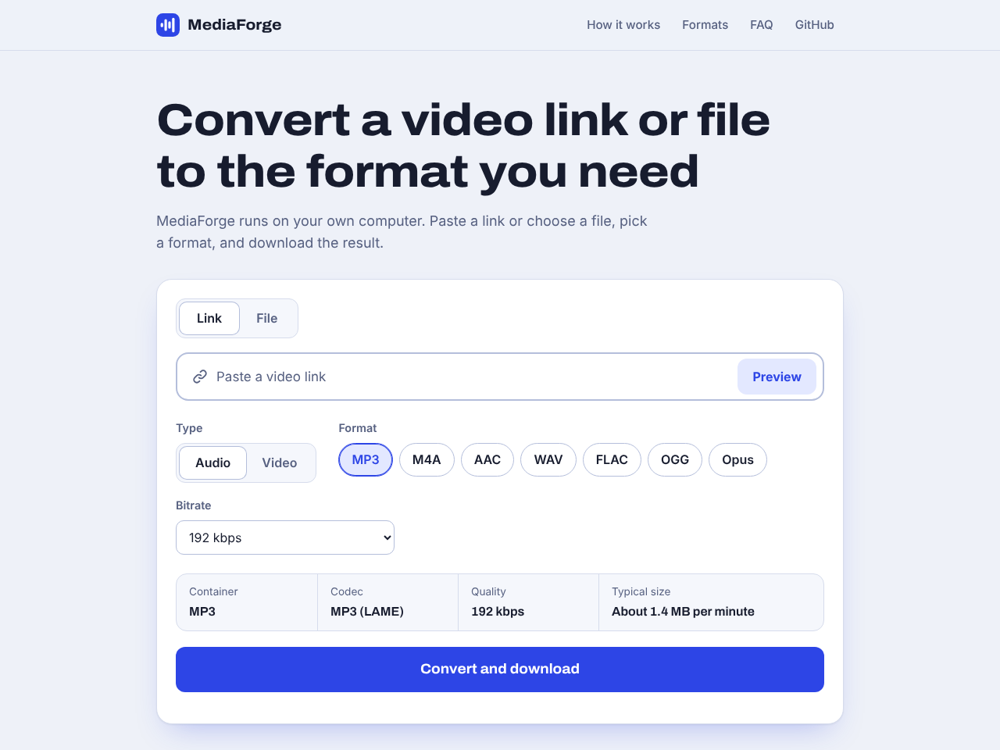

# MediaForge

[](https://github.com/alwinsibym/mediaforge/actions/workflows/ci.yml)
[](LICENSE)


A media converter that runs on your own machine. Paste a video URL or upload a local file, choose a format, and download the result as MP3, M4A, AAC, WAV, FLAC, OGG, Opus, MP4, WebM or MKV.

It uses only free, open-source tools: [FastAPI](https://fastapi.tiangolo.com/), [yt-dlp](https://github.com/yt-dlp/yt-dlp) and [FFmpeg](https://ffmpeg.org/). No accounts, API keys or paid services.




[Watch the demo as a video](docs/demo.mp4)

## Features

- Convert from a video URL (any site supported by yt-dlp) or from an uploaded audio/video file.
- Audio formats: MP3, M4A, AAC, WAV, FLAC, OGG, Opus, with selectable bitrate for lossy formats.
- Video formats: MP4, WebM, MKV, with a maximum-resolution option (360p to 1080p, or best available).
- Preview the title, uploader and duration of a URL before converting.
- Convert a whole playlist: pick the videos you want, then save them to a folder on your computer, download a ZIP, or both.
- Title, artist, album and cover art are written into the files (MP3, M4A, FLAC, Ogg, Opus, MP4, MKV). Playlist items get the playlist name as album and their position as track number.
- Car presets for the Sony XAV-W650BT and similar older head units (see below).
- Configurable limits for video length and upload size.
- Temporary files are deleted after each download.
- Pasting a link shows the thumbnail, title, channel, length, views and date, and lists only the video qualities that video really has (4K, 1440p60, 1080p and so on). Nothing is upscaled.
- Download the thumbnail in any size the site offers, as JPG, PNG or WebP, optionally cropped to a square.
- Video without sound (any quality), and square cover art that car units and Windows can show on MP3 and M4A files.
- Works on phones and tablets too: see "Using it from other devices".
- Live progress for every download: percent, speed and time left, with a Cancel button. Failed downloads caused by a passing site error are retried automatically.
- Faster downloads: M4A and Opus are copied from the source without re-encoding when it already uses that codec, several playlist videos download at once (1 to 3), and fragmented videos are fetched in parallel. aria2c can be switched on in Settings.
- Optional extras: even out the volume, skip sponsor segments (YouTube), embed subtitles, download only part of a video, split by chapter into a ZIP.
- Sites that need a sign-in (Reddit, age-restricted YouTube, YouTube's "confirm you're not a bot") work by using the sign-in of a browser on your computer, chosen in Settings.
- History of finished downloads with Use again, and a button that updates yt-dlp.
- Optional proxy and "imitate Chrome's connection" (needs `pip install curl_cffi`) in Settings, for networks or sites that refuse plain downloaders.
- Safer on a network: links to private addresses are blocked, jobs are limited, and an optional access token protects `--lan` use.
- Every error has a plain-English title, a code such as `MF-NET-01` and an expandable explanation of what happened, why, and what to do next (the codes are listed in `backend/app/errors.py`).
- Rename a single link or an uploaded file before converting; the new name is used for the file and the title tag.
- Dark, Light or System theme (the default follows your device), chosen with the toggle in the header and remembered in your browser.
- Responsive layout.

## How it works

```
Browser (HTML/CSS/JS)  ->  FastAPI backend  ->  yt-dlp (download)  ->  FFmpeg (convert)
                                            ->  FFmpeg (uploaded files)
```

The backend serves the frontend and a small JSON/file API. For a URL, it downloads the media with yt-dlp and lets FFmpeg convert it. For an uploaded file, it runs FFmpeg directly. The converted file is streamed back and its temporary folder is removed.

## Requirements

- Python 3.10 or newer
- FFmpeg on your `PATH`
- A JavaScript runtime for YouTube (yt-dlp requires one). The Python requirements install [Deno](https://deno.com/) for you on most platforms. If your platform has no Deno package, install Node.js 20 or newer instead.

## Quick start with Docker

Docker bundles Python, FFmpeg and the JavaScript runtime, so nothing else needs installing.

```bash
git clone https://github.com/alwinsibym/mediaforge.git
cd mediaforge
docker compose up --build
```

Open <http://localhost:8000>.

**Windows without Python:** download `MediaForge-<version>-windows.zip` from the [Releases page](https://github.com/alwinsibym/mediaforge/releases), unzip it and double-click `MediaForge.exe`.

New to this? [docs/INSTALL.md](docs/INSTALL.md) is a step-by-step Windows guide with pictures.

## Manual setup

1. Install FFmpeg.

   | System | Command |
   | --- | --- |
   | Windows | `winget install Gyan.FFmpeg` (then open a new terminal) |
   | macOS | `brew install ffmpeg` |
   | Debian/Ubuntu | `sudo apt install ffmpeg` |

2. Clone the repository and install the Python dependencies.

   Windows (PowerShell):

   ```powershell
   git clone https://github.com/alwinsibym/mediaforge.git
   cd mediaforge\backend
   python -m venv .venv
   .venv\Scripts\Activate.ps1
   pip install -r requirements.txt
   ```

   If PowerShell blocks the activation script, run `Set-ExecutionPolicy -Scope Process Bypass` first.

   macOS / Linux:

   ```bash
   git clone https://github.com/alwinsibym/mediaforge.git
   cd mediaforge/backend
   python3 -m venv .venv
   source .venv/bin/activate
   pip install -r requirements.txt
   ```

3. Start the server. From the project folder this works on every system:

   ```bash
   python run.py
   ```

   (Developers can also run `uvicorn app.main:app --reload` from the `backend` folder.)

4. Open <http://localhost:8000>.

To check that FFmpeg and the JavaScript runtime were found, open <http://localhost:8000/api/health>. It reports `"ffmpeg": true` and lists the detected runtimes under `js_runtimes`.

### A desktop shortcut (no terminal)

With your virtual environment active, run once:

```
python scripts/create_shortcut.py
```

It puts a **MediaForge** icon on your Desktop (add `--start-menu` for the Start Menu on Windows). Double-click it to start the server with no console window and open the page in your browser. If MediaForge is already running, it only opens the page. Use the power button at the top right of the page to stop it. Messages go to `data/mediaforge.log`. Remove the shortcut with `python scripts/create_shortcut.py --remove`.

The Windows shortcut is tested only through its generated PowerShell, and the macOS `.command` file has not been tried, so report anything odd.

## Usage

1. Choose the **Link**, **File** or **Playlist** tab.
2. Enter a link (use **Preview** to check it first), choose a file, or paste a playlist link and select **Load playlist**.
3. Pick an output format and quality.
4. Select **Convert and download**. Long videos and large files can take a few minutes.

### More options, Settings and History

Under **More options** you can even out the volume (so songs from different videos play at the same loudness), skip sponsor and self-promotion parts (YouTube only), embed subtitles in a video, download only part of a video (for example 1:20 to 3:45), and split a video into one file per chapter (you get a ZIP). Trimming and chapter splitting work on one link at a time.

The two buttons in the header open **History** (finished downloads, each with **Use again**) and **Settings**. They only appear on the computer running MediaForge.

- **Sign-in:** choose the browser where you are signed in, or give a `cookies.txt` file. This is how Reddit videos, age-restricted videos and YouTube's "confirm you're not a bot" check are handled. Firefox is the most reliable. With Chrome or Edge, close the browser first, as recent versions can block it. Sites may limit accounts that download a lot, so a spare account is safer.
- **Speed:** how many playlist videos download at the same time (default 2), and aria2c for more connections per file when it is installed. aria2c cannot report a percentage, so the progress bar stays animated without a number.
- **Update yt-dlp:** one click instead of a terminal command. Restart MediaForge afterwards to use the new version. With Docker, rebuild the image instead.

**No internet:** if the connection drops, downloads pause and carry on by themselves when it is back (for up to 30 minutes per video). Videos that could not be finished, whether the connection never returned, the site kept refusing, or MediaForge was closed, are listed under **Unfinished downloads** at the top of the page with **Resume** and **Remove**. Resume saves them into the same folder with their original numbers. This list covers playlist jobs that save to a folder.

If YouTube keeps asking for a sign-in check during a long playlist, MediaForge waits and retries, and if it keeps happening it stops and keeps what it saved. Choose **Retry** later and the failed videos are saved into the same folder with their original numbers.

### Check it first: a 10-second sample

On the File tab, **Try a 10-second sample** converts ten seconds from the middle of your file with the choices you made, shows it in a player, and estimates the whole job ("the whole file: 38 MB, converting takes about 40 seconds"). The estimate comes from timing the sample, so it follows your codec, resize, size target and graphics card choices. It is an estimate, not a promise. The sample is deleted after 20 minutes.

### Use my graphics card

**Settings → Use my graphics card** encodes H.264 and H.265 video on an NVIDIA card (NVENC), which is usually several times faster than the processor. It is off by default. MediaForge tests the card by encoding one tiny frame, so the switch is greyed out if it will not work. If a conversion ever fails on the card, MediaForge turns the card off for that session and redoes the job on the processor. VP9 and AV1 always use the processor (the RTX 30 series cannot encode AV1).

### Tweaks for your own files

On the **File** tab, open **Tweaks** to change a file while converting it. Nothing is required; leave it closed for a plain conversion.

- **Video codec**: H.264, H.265, VP9 or AV1 (the list greys out what your FFmpeg cannot do).
- **Resize**: 360p up to 4K, up or down.
- **Make it smaller than**: give a size in MB. MediaForge plans the bitrate for the clip length and retries if the first try was too big.
- **Sound**: volume, fade in, fade out, and a sound effect (bass boost, treble boost, clearer voice, wider stereo, headphone crossfeed, virtual surround) and spatial sound (below). "Even out the volume" is under More options. You can also replace the sound with another audio file, or tick "Remove the sound" for a silent video. Audio-only extraction is the Audio type.
- **Cover picture**: replace the thumbnail shown in players and file managers (MP3, M4A, FLAC, MP4, MKV). JPG, PNG or WebP.
- **Subtitles**: add an .srt, .vtt or .ass file as a selectable track, or burn it into the picture.
- **Start and stop**: keep only part of the file.
- **Animated picture**: turn a clip of up to a minute into a GIF or an animated WebP.
- **Remove hidden details**: strips location, device and tags before you share a file.
- **Show file info**: codec, bitrate, streams and length, without converting.

The Sony car presets do not take tweaks.

### Spatial sound (use headphones)

Under Tweaks, **Spatial sound** places the sound around your head, or moves it. It works for audio and video output. It uses FFmpeg's `sofalizer` filter with a measured head model (MIT KEMAR, bundled in `backend/app/data`, see `HRTF-NOTICE.txt`).

- **Orbit around your head (8D)**: the sound circles you. Choose how many seconds one full turn takes (2 to 60).
- **Travel front to back**: the sound passes from in front of you to behind and back.
- **From the front, behind, the left side, the right side or above**: every sound comes from that spot.
- **Speakers in a room**: keeps the stereo picture, as two speakers placed in front of you.
- **Movie-style surround**: a 5.1 film mix keeps its front, side and rear sound on headphones. A stereo file is spread into 5.1 first, which is a guess.

Spatial sound only works on headphones, and it is a simulation: a normal file has no stored positions. Turn Windows Sonic or Dolby Atmos off while you listen, or they will reshape the result again. If the head model file or the `sofalizer` filter is missing, only the Orbit option stays, as a simple left-right sweep.

### Playlists

Paste a playlist link on the **Playlist** tab and select **Load playlist**. Untick any videos you do not want, choose where the files go, then start the job. Videos are converted one after another, and any that fail (private or removed videos, for example) are listed and skipped.

- **Save to a folder on this computer** puts the files in `downloads/<playlist name>` inside the project folder (change it with `MEDIAFORGE_DOWNLOAD_DIR`). Files are named `01 - Title.mp3` so they play in playlist order. Copy the folder to a USB stick.
- **Make a ZIP to download** builds a ZIP you can download when the job finishes.
- Both can be on at the same time.

### Video quality, 4K and 8K

When you paste a link, the Quality menu lists what that video offers, for example `2160p60 (4K)`, `1440p30 (2K)` and `1080p`, with an estimated size. A video that only has 720p will only list 720p. Above 1080p, YouTube provides VP9 or AV1 video instead of H.264, so **MKV or WebM** plays these most reliably. MP4 works too, but may not play on older devices. On the File and Playlist tabs the menu is a maximum ("Up to 1440p"), and each video is downloaded at the best quality it has up to that limit.

### Thumbnails, covers and sound

- **Download thumbnail** (under the video preview) saves the thumbnail in any size the site lists, as JPG, PNG or WebP, optionally cropped to a square.
- **MP3 and M4A** files get a square cover and the title, artist and album. If a cover cannot be added, the page says so after the download.
- **Remove the sound** (video formats) gives a silent video at the quality you picked.

### Recording the demo

`python scripts/record_demo.py https://youtu.be/VIDEO_ID` records the page in a real browser, runs a real download and writes `docs/demo.gif` and `docs/demo.mp4`. Use a video you own or that is licensed for copying. `--sample` uses made-up data and needs no internet.

### Using it from other devices

MediaForge runs on one computer, and any device with a browser can use it:

| Device | How |
| --- | --- |
| Windows, macOS, Linux | Install the requirements and run `python run.py`. |
| Android phone or tablet | Open it from the computer (below), or run it on the phone itself with [Termux](https://termux.dev/): `pkg install python ffmpeg`, then `pip install -r backend/requirements.txt` and `python run.py`. |
| iPhone and iPad | Open it from the computer (below). iOS cannot run the server itself. |

To use a phone or tablet with your computer, start the server with `python run.py --lan` and open the address it prints (for example `http://192.168.1.20:8000`) on a device on the same Wi-Fi. In your browser's menu, **Add to Home screen** (or **Install app**) puts it on the home screen like an app. Converted files download to the phone. A playlist's "save to a folder" option saves on the computer running MediaForge, and the Open folder button only works there.

`--lan` lets anyone on the network use MediaForge, and it has no sign-in. Use it on a network you trust, and never expose it to the internet.

### Older car head units (Sony XAV-W650BT)

This Sony unit cannot play the H.264 video that normal MP4 files use. According to Sony's manual it plays only:

| Container | Video | Audio | Limits |
| --- | --- | --- | --- |
| MP4 | MPEG-4 Simple Profile | AAC | 4 Mbps, 720 x 576, 30 fps |
| AVI | Xvid (MPEG-4 ASP) | MP3 | 8 Mbps, 720 x 576, 30 fps |

Choose **Video**, then **Sony car MP4** (about 3.3 Mbps video and 192 kbps AAC audio) or **Sony car AVI** (about 6.5 Mbps video and 192 kbps MP3 audio). Try the MP4 first and use the AVI if it will not play. Format the USB stick as FAT32. For music only, use MP3 at 192 kbps or lower, because Sony lists 48 to 192 kbps for MP3. The files are stereo. The unit's Dolby Digital decoding is for DVD discs, and its four speakers are fed from the stereo signal, so use the unit's own sound settings (EQ and fader) to shape it. These presets were checked with FFmpeg, not on a real head unit, and Sony says playback is not guaranteed.

## API

| Method | Path | Description |
| --- | --- | --- |
| GET | `/api/health` | Server status, FFmpeg availability, detected JavaScript runtimes |
| GET | `/api/formats` | Supported formats, quality options and limits |
| POST | `/api/info` | Body `{"url": "..."}`. Returns title, duration, uploader, views, date, thumbnails, and the available video qualities |
| POST | `/api/thumbnail` | Body `{"url": "...", "id": "...", "format": "jpg", "square": false}`. Returns the thumbnail image |
| POST | `/api/convert` | Body `{"url": "...", "format": "mp3", "quality": "192", "mute": false}`. Video quality can be `best`, a height such as `2160`, or a height and frame-rate cap such as `1440@30`. Returns the converted file |
| POST | `/api/playlist/info` | Body `{"url": "..."}`. Lists the videos in a playlist |
| POST | `/api/jobs` | Starts a job: `title`, `items` (`title`, `url`, optional `number`), `format`, `quality`, `save_to_folder`, `make_zip`, optional `options` (`normalize`, `sponsorblock`, `subtitles`, `subtitle_langs`, `trim_start`, `trim_end`, `split_chapters`) and `continue_job` |
| GET, POST | `/api/settings` | Read or change the settings (this computer only) |
| GET, DELETE | `/api/history` | List or clear finished downloads (this computer only) |
| POST | `/api/update-ytdlp` | Upgrades yt-dlp (this computer only) |
| GET | `/api/jobs/{id}` | Progress of a job, with the state of each video |
| POST | `/api/jobs/{id}/cancel` | Stops after the current video |
| GET | `/api/jobs/{id}/zip` | Downloads the job's ZIP |
| POST | `/api/jobs/{id}/open-folder` | Opens the job's folder in the file manager |
| POST | `/api/jobs/upload` | Multipart form: `file`, `format`, optional `quality`, `mute`, `normalize`, `title`, `options` (JSON string: `video_codec`, `resize`, `volume`, `fade_in`, `fade_out`, `effect`, `target_mb`, `strip_metadata`, `subtitles`, `animated`, `animated_width`, `start`, `end`), `audio_file`, `subtitle_file` |
| POST | `/api/probe` | Multipart form with `file`. Returns codec, bitrate, streams and length |
| POST | `/api/convert-file` | Multipart form with `file`, `format`, optional `quality`. Returns the converted file |

Interactive API docs are available at <http://localhost:8000/docs> while the server is running.

Errors are returned as JSON, for example `{"detail": "Unsupported format 'exe'."}`.

## Configuration

Set these environment variables before starting the server (or in `docker-compose.yml`).

| Variable | Default | Meaning |
| --- | --- | --- |
| `MEDIAFORGE_MAX_DURATION` | `0` | Longest video accepted from a URL, in seconds. `0` means no limit |
| `MEDIAFORGE_MAX_UPLOAD_MB` | `0` | Largest uploaded file, in megabytes. `0` means no limit |
| `MEDIAFORGE_DOWNLOAD_DIR` | `../downloads` | Where playlist folders are saved |
| `MEDIAFORGE_MAX_PLAYLIST_ITEMS` | `200` | Most videos accepted from one playlist |
| `MEDIAFORGE_DATA_DIR` | `../data` | Where settings and history are kept |
| `MEDIAFORGE_TRUST_CLIENTS` | (off) | Set to `1` to let every client use Settings, History and updates (the Docker setup does, with its port limited to this computer) |
| `MEDIAFORGE_FRONTEND_DIR` | `../frontend` | Folder served as the web UI |
| `MEDIAFORGE_FFMPEG_DIR` | (auto-detect) | Folder containing `ffmpeg`, for when it is installed but not on the `PATH` |
| `MEDIAFORGE_MAX_ACTIVE_JOBS` | `5` | Jobs allowed to wait or run at once; more are refused |
| `MEDIAFORGE_ALLOW_PRIVATE` | (off) | Set to `1` to allow links to `127.0.0.1`, `192.168.x.x` and other private addresses (blocked by default) |
| `MEDIAFORGE_TOKEN` | (none) | An access token. Devices other than this computer must enter it once. Use it whenever you start with `--lan` |

## Development

Three scripts check the app: `python scripts/ui_smoke.py` clicks through every screen in a real browser (needs `pip install playwright` and `python -m playwright install chromium`), `python scripts/selftest.py` converts generated media to every format and verifies the result, and `python scripts/check_sites.py sites.txt` writes a report of which sites work. See [docs/TESTING.md](docs/TESTING.md).

```bash
cd backend
pip install -r requirements-dev.txt
ruff check .
pytest
```

The tests generate their own sample media with FFmpeg and mock the download step, so they need no network access. GitHub Actions runs the linter, the tests and a Docker build on every push.

## Project structure

```
mediaforge/
├── backend/
│   ├── app/
│   │   ├── main.py          # FastAPI app and endpoints
│   │   ├── downloader.py    # yt-dlp download and conversion
│   │   ├── transcoder.py    # FFmpeg conversion for uploaded files and the car presets
│   │   ├── tweaks.py        # Validated file tweaks and the FFmpeg arguments they make
│   │   ├── jobs.py          # background playlist jobs
│   │   ├── cover.py         # square cover art for MP3 and M4A
│   │   ├── ffmpeg_locator.py # finds FFmpeg even when the PATH is stale
│   │   ├── formats.py       # supported formats and quality options
│   │   ├── validators.py    # URL and filename validation
│   │   └── config.py        # settings and limits
│   ├── tests/
│   ├── requirements.txt
│   └── requirements-dev.txt
├── frontend/
│   ├── index.html
│   ├── style.css
│   ├── js/              # the page code as ES modules (main.js starts it)
│   ├── package.json     # only for the JavaScript lint tool
│   ├── manifest.webmanifest # lets phones add it to the home screen
│   ├── icons/
│   ├── favicon.svg
│   └── fonts/           # Archivo variable font (SIL OFL)
├── run.py                   # starts the server (--lan for other devices)
├── scripts/find-ffmpeg.ps1  # Windows helper: locate ffmpeg.exe
├── docs/screenshot.png
├── Dockerfile
├── docker-compose.yml
└── .github/workflows/ci.yml
```

## Troubleshooting

**"FFmpeg was not found on this computer", a red banner on the page, or `"ffmpeg": false` on the health page.** Merging video and audio (for example MP4 at 1080p) and converting formats need FFmpeg. MediaForge looks on the `PATH`, in the folder named by `MEDIAFORGE_FFMPEG_DIR`, and in the usual WinGet, Chocolatey and `C:\ffmpeg` locations. If it is installed but still not found, run `powershell -ExecutionPolicy Bypass -File scripts\find-ffmpeg.ps1` from the project folder. It finds `ffmpeg.exe` and prints the exact setting to use. Start MediaForge from the same terminal where you set it, or use `setx` and open a new terminal.

**YouTube downloads fail or report missing formats.** yt-dlp needs a JavaScript runtime. Check `js_runtimes` on the health page. If it is empty, install Deno (`pip install deno`) or Node.js 20+.

**Downloads that worked stop working.** Sites change often. Update yt-dlp with `pip install -U "yt-dlp[default]"` (or rebuild the Docker image with `docker compose build --no-cache`).

**"Could not reach that site" or `getaddrinfo failed`.** This computer could not look up the site's address, so it is a network or DNS problem rather than a MediaForge one. Check the connection, a VPN or firewall, and whether the site opens in your browser. Some networks block certain sites.

**"HTTP Error 403: Forbidden" during a download.** The site refused one request. MediaForge retries up to three times and only then shows an error. If it keeps happening, update yt-dlp (see above).

**"No video could be found in this tweet" (X).** The post has only text or pictures, the video belongs to a quoted or replied-to post (paste that post's link), or X hides it from visitors who are not signed in (choose your browser in Settings). MediaForge saves videos and audio, not images.

**"Connection timed out".** The site did not answer. It may be down, slow, or blocked by your network, VPN or firewall. Check that it opens in your browser.

**Only part of a big playlist downloaded.** YouTube limits how fast one connection can ask for many videos. MediaForge spaces the videos out, waits when YouTube asks for a check, and stops with a **Retry** button if it keeps happening. Set your browser under Settings, use 1 parallel download, and retry after a few minutes.

**"Sign in to confirm you're not a bot".** Some networks and IP addresses are challenged by YouTube. This is more common from cloud servers than from a home connection. Running MediaForge locally usually avoids it.

## Responsible use

MediaForge is for personal use with content you own, content under a licence that permits copying (such as Creative Commons), or other material you have the right to download. Many sites, including YouTube, restrict downloading in their terms of service, and copyright law applies. You are responsible for how you use this tool. It is designed to run locally and is not intended to be hosted as a public conversion service.

This project was made for learning and experimenting. It is kept on GitHub as source code and documentation only, with no public website or hosted service, and it is meant to be run by each person on their own computer. See [docs/TESTING.md](docs/TESTING.md) for the checklist used to test it, [docs/RELEASING.md](docs/RELEASING.md) for how versions work, and [CHANGELOG.md](CHANGELOG.md) for what changed.

## Licence

MIT. See [LICENSE](LICENSE).
