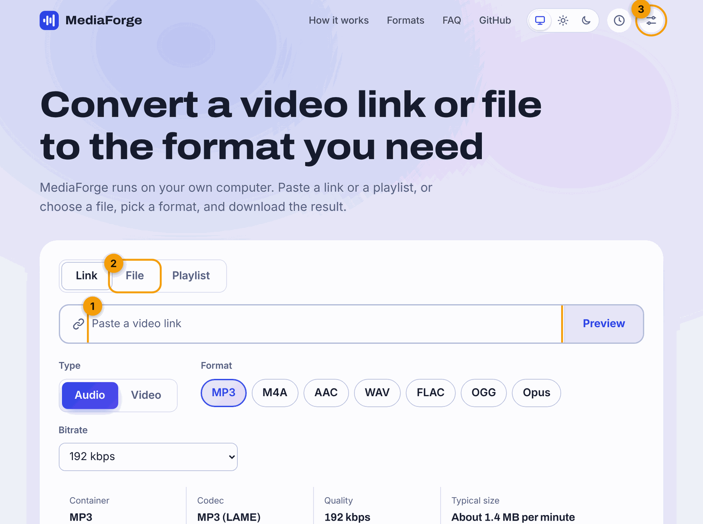
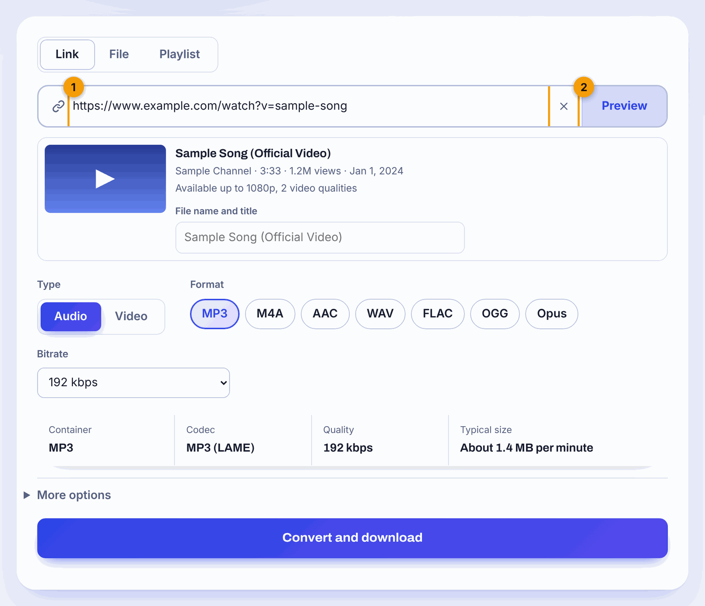
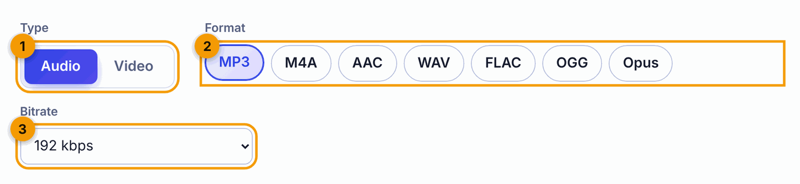
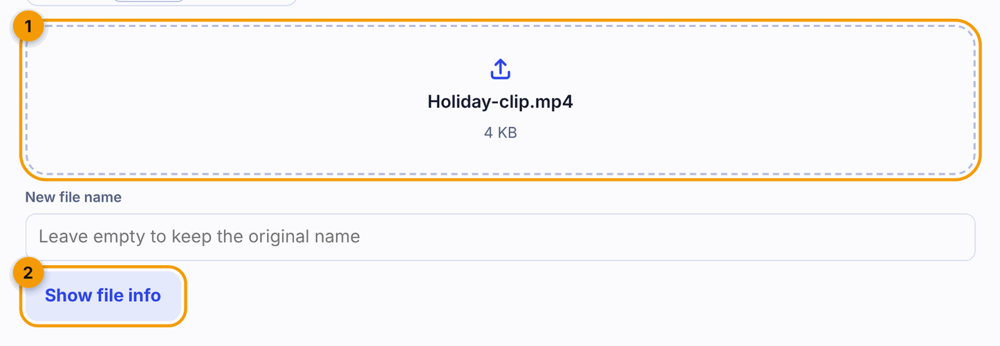
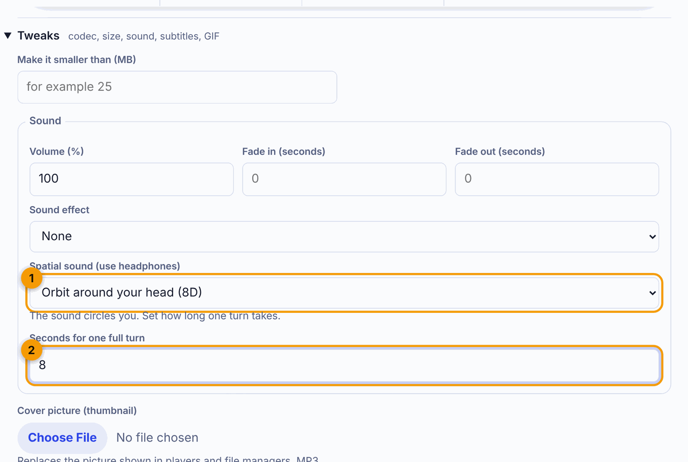
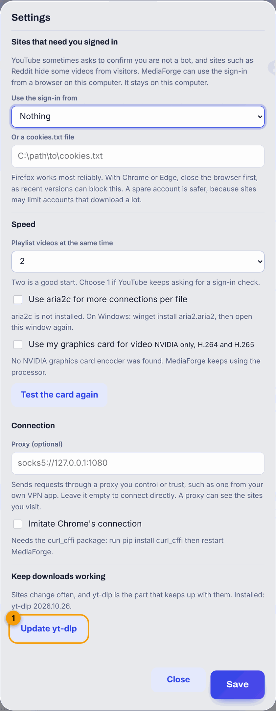
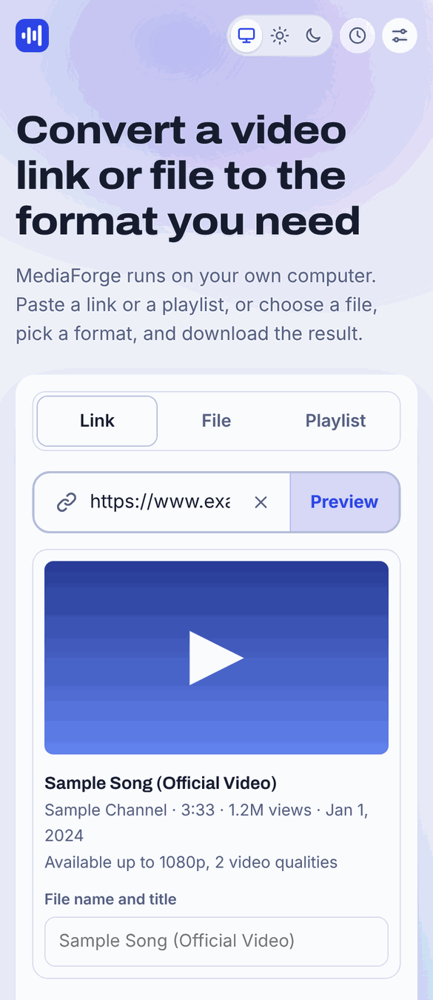

# MediaForge: install and first use

A step-by-step guide for Windows, with pictures. All names, links and files in the pictures are made up. Mac and Linux steps are in the [README](../README.md#manual-setup).

MediaForge runs on your own computer. It opens as a page in your browser, but nothing is sent to anyone else.

## 1. What you need

| Item | How to get it |
| --- | --- |
| Python 3.10 or newer | `winget install Python.Python.3.12` |
| FFmpeg (does the converting) | `winget install Gyan.FFmpeg` |
| The MediaForge files | Download the zip from the [Releases page](https://github.com/alwinsibym/mediaforge/releases) (choose **Source code (zip)**) and unzip it. Or run `git clone https://github.com/alwinsibym/mediaforge.git`. |

Run the two `winget` commands in PowerShell, then **close PowerShell and open a new one**, so Windows finds the new programs.

## 2. Install and start

In the new PowerShell window, go into the MediaForge folder (the one that contains `run.py`) and run:

```powershell
cd backend
python -m venv .venv
.venv\Scripts\Activate.ps1
pip install -r requirements.txt
cd ..
python run.py
```

If PowerShell refuses to run the activation line, run `Set-ExecutionPolicy -Scope Process Bypass` first and try again.

Leave that window open. Open **<http://localhost:8000>** in your browser.

Optional: `python scripts/create_shortcut.py` puts a MediaForge icon on your Desktop, so next time you only double-click it. The power button at the top right of the page stops the program.

If the page shows a red banner about FFmpeg, see [If something goes wrong](#8-if-something-goes-wrong).

## 3. Convert a link



1. Paste a video link into the box.
2. The **File** tab is for files already on your computer (step 5).
3. **Settings** (top right) is where you update yt-dlp (step 7).

Click **Preview** to check the link. The title, length and available qualities appear:



1. The link you pasted.
2. **Preview** looks the video up without downloading it.

Now choose what you want:



1. **Type**: Audio or Video. The switch slides between them.
2. **Format**: for example MP3 for music, MP4 for video.
3. **Bitrate** (audio) or **Maximum resolution** (video). Higher means better quality and a bigger file.

Click **Convert and download**. When it finishes, the file downloads in your browser:


## 4. Convert several videos (playlist)

Open the **Playlist** tab, paste a playlist link and click **Load playlist**. Tick the videos you want, choose a format and convert. Videos that are private or removed are skipped, and the rest still download.

## 5. Convert a file you already have

Open the **File** tab and choose a file, or drop it onto the box. **Show file info** lists its codecs, size and length without converting it.



1. The file you picked.
2. **Show file info**.

## 6. Tweaks

Under **Tweaks** you can make the file smaller than a size you set, change the volume, add fades, and more. **Spatial sound** places the sound around your head. Use headphones, and turn Windows Sonic and Dolby Atmos off while you listen.



1. **Spatial sound**: orbit around your head, travel front to back, or fix the sound to the front, behind, left, right or above. *Movie-style surround* keeps the front, side and rear sound of a 5.1 film.
2. **Seconds for one full turn**: how fast an orbit or sweep goes.

Before a long conversion, use **Try a 10-second sample** to hear the result and see an estimate of the size and time.

## 7. Keep downloads working

Websites change often, and yt-dlp is the part that keeps up with them. If links that used to work stop working, open **Settings** and click **Update yt-dlp**, then restart MediaForge.



1. **Update yt-dlp**.

The same window has the option to use your NVIDIA graphics card for video and to use your browser's sign-in for sites that ask you to log in.

### On a phone or tablet

Start MediaForge with `python run.py --lan` and open the address it prints on a device on the same Wi-Fi. The page fits small screens. Converted files download to that device.



## 8. If something goes wrong

| What you see | What to do |
| --- | --- |
| "FFmpeg was not found" | Open a new PowerShell window after installing FFmpeg and start MediaForge again. If it still fails, run `powershell -ExecutionPolicy Bypass -File scripts\find-ffmpeg.ps1` from the MediaForge folder. |
| A link that worked before fails | Update yt-dlp (step 7). |
| YouTube asks you to sign in | In **Settings**, choose the browser you are signed in with. |
| The page looks wrong after an update | Press **Ctrl + F5**. |
| Anything else | Open `data/mediaforge.log`, and report the problem at <https://github.com/alwinsibym/mediaforge/issues> with the error text. |

## Updating MediaForge

Download the newest release the same way and copy your `data` folder across, or run `git pull` if you used `git clone`. Then restart MediaForge.
